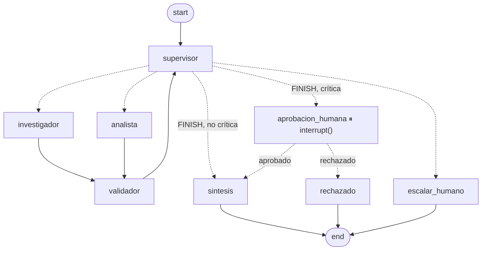

# Pre-entrega 7: API de producción y monitoreo activo

API REST asíncrona (**FastAPI**) que expone el orquestador multi-agente del Módulo 6 (Supervisor + Investigador + Analista + Validador, con **LangGraph** y **Gemini**). Responde preguntas sobre las políticas internas de *TechCorp*.

| Capacidad | Implementación |
|---|---|
| Endpoints asíncronos | `POST /tasks` encola en **Arq** y devuelve `job_id` en milisegundos (202). El grafo corre en un **worker separado**. |
| Estado en Redis | Cada job es un hash en Redis (`PENDING → RUNNING → WAITING_APPROVAL → DONE / FAILED`). Los checkpoints de LangGraph se guardan con **`AsyncRedisSaver`**. |
| Observabilidad | **LangSmith**: traza por ejecución con cada nodo, cada llamada a Gemini (tokens y costo) y cada tool. |
| Human-in-the-loop | El nodo `aprobacion_humana` hace `interrupt()` en las tareas **críticas**. `POST /tasks/{id}/approve` retoma el grafo desde el checkpoint. |
| Manejo de errores | Una excepción o un timeout llevan el job a `FAILED`. Una tarea periódica (`reaper`) marca `FAILED` los jobs que quedan huérfanos si el worker muere. |

## Arquitectura

```
                     ┌──────────────── Redis (8 / Stack) ────────────────┐
 cliente ──POST /tasks──▶ API FastAPI ──enqueue──▶ cola Arq ──▶ Worker Arq │
    ▲                    │   (async)                              │        │
    │                    ├─ job:{id} (hash de estado) ◀───────────┤        │
    └──GET /tasks/{id}───┘                                        │        │
                                                checkpoints ◀─────┤ grafo LangGraph
                                                (AsyncRedisSaver) │  (M6 + HITL)
                                                                  └──trazas──▶ LangSmith
```

```
mi-api-agente/
├── app/
│   ├── main.py            # FastAPI: POST /tasks · GET /tasks/{id} · GET /tasks · GET /health
│   ├── graph.py           # orquestador del M6 + nodo HITL + AsyncRedisSaver
│   ├── worker.py          # worker de Arq: ejecuta/reanuda el grafo y actualiza el estado en Redis
│   ├── jobs.py            # estado de los jobs en Redis (compare-and-set atómico en Lua)
│   ├── observability.py   # init de LangSmith, @traceable y metadata de traza
│   ├── hitl.py            # criterio de criticidad + interrupt() + POST /tasks/{id}/approve
│   └── config.py          # parámetros desde .env
├── orquestador/           # sistema multi-agente del Módulo 6 (agentes, estado, validador, tools)
├── data/                  # políticas de TechCorp (corpus del RAG)
├── scripts/
│   ├── carga_concurrente.py   # 5 peticiones concurrentes + p50/p95 end-to-end
│   └── metricas_langsmith.py  # costo por ejecución, p95 y tokens por nodo, leídos de LangSmith
├── tests/                 # 33 tests offline (sin API keys, con fakeredis)
├── screenshots/           # evidencia del dashboard de LangSmith
├── docs/grafo.mmd         # diagrama del grafo
├── requirements.txt       # (+ requirements-rag.txt opcional para Pinecone)
├── docker-compose.yml     # redis + api + worker
└── .env.example
```

### El grafo



## Puesta en marcha

Requisitos: Python 3.12+ y un Redis con los módulos **JSON y Search** (Redis 8, Redis Stack o Redis Cloud). El `AsyncRedisSaver` los usa para indexar los checkpoints, así que un Redis 6/7 común no alcanza.

### 1. Instalar

```bash
git clone <este-repo> && cd <este-repo>
python -m venv .venv
.venv\Scripts\activate          # Windows  (Linux/macOS: source .venv/bin/activate)
pip install -r requirements.txt
cp .env.example .env            # y completá las claves
```

### 2. Inicializar Redis (elegí una opción)

**A. Redis Cloud (gratis, sin instalar nada)**
1. Creá una base *Essentials (Free 30 MB)* en <https://redis.io/try-free/>. Ya trae JSON y Search.
2. En la base, *Connect → Redis CLI* muestra el host, el puerto y el password.
3. En `.env`: `REDIS_URL=redis://default:<password>@<host>:<puerto>/0` (usá `rediss://` si la base tiene TLS).

**B. Docker**
```bash
docker compose up -d redis      # Redis 8 en localhost:6379 → REDIS_URL=redis://localhost:6379/0
```

No hace falta crear índices a mano: el worker ejecuta `AsyncRedisSaver.asetup()` al arrancar.

### 3. Configurar LangSmith

1. Creá una cuenta en <https://smith.langchain.com> → *Settings → API Keys*.
2. En `.env`: `LANGSMITH_TRACING=true`, `LANGSMITH_API_KEY=...` y `LANGSMITH_PROJECT=api-agente-produccion`.
3. **Precio del modelo:** LangSmith calcula el costo con su tabla de precios. Si el modelo de `GEMINI_MODEL` no figura, el costo aparece vacío. Para cargarlo, andá a *Settings → Model Pricing → Add model*, poné el nombre del modelo como *match pattern* y los precios de entrada y salida por 1M de tokens.

### 4. Límites de Gemini (plan gratuito)

El plan gratuito tiene topes **por modelo**. `gemini-3.5-flash` permite 20 requests por día, y una ejecución hace unas 8, así que la prueba de 5 no entra. `gemini-3.5-flash-lite` permite 15 requests por minuto. La prueba de carga se corrió con:

```
GEMINI_MODEL=gemini-3.5-flash-lite
GEMINI_RPM=14        # rate limiter compartido: con 5 tareas concurrentes, las llamadas esperan su turno en vez de recibir 429
```

### 5. Levantar la API y el worker (dos terminales)

```bash
uvicorn app.main:app --port 8000          # terminal 1: API → http://localhost:8000/docs
arq app.worker.WorkerSettings             # terminal 2: worker
```

Con Docker, `docker compose up --build` levanta los tres servicios.

## Uso de la API

```bash
# 1) Encolar: responde al instante con el job_id
curl -X POST localhost:8000/tasks -H "Content-Type: application/json" \
  -d '{"pregunta": "Un líder de equipo no usó su presupuesto de capacitación el año pasado. Este año quiere hacer un curso de 2300 USD. ¿Cuánto le sobra o le falta?"}'
# → {"job_id": "3f2c...", "status": "PENDING", ...}

# 2) Polling
curl localhost:8000/tasks/3f2c...
# → "status": "WAITING_APPROVAL", "aprobacion_pendiente": {"motivos": ["Impacto económico: ..."],
#    "propuesta": {"hallazgos": [...], "calculo": "1500*2 - 2300 = 700"}}

# 3) Decisión humana (aprobado: false descarta la respuesta)
curl -X POST localhost:8000/tasks/3f2c.../approve -H "Content-Type: application/json" \
  -d '{"aprobado": true, "revisor": "rrhh", "comentario": "monto verificado"}'

# 4) Polling hasta DONE → "resultado": {"respuesta_final": "...", "bitacora": [...]}
```

Para demostrar el camino de error, enviá `"simular_fallo": true` en `POST /tasks`: el worker lanza una excepción y el job termina en `FAILED` con el error, sin quedar colgado en `RUNNING`.

### ¿Cuándo una tarea es "crítica"? (`app/hitl.py`)

El criterio es determinístico, sin LLM, y se evalúa cuando el supervisor decide finalizar:

1. **Impacto económico:** algún dato validado está en USD/$/ARS/EUR, o la pregunta habla de dinero y hay un cálculo validado (por ejemplo, "la hora vale 12 USD, ¿cuánto cobra?"). La respuesta informa dinero que después se paga (horas extra, presupuestos, reintegros): es la acción con efectos secundarios.
2. **Costo alto:** la ejecución usó al menos `HITL_UMBRAL_PASOS` pasos (6 por defecto) del supervisor, porque hubo reparaciones y la corrida salió cara.

Mientras espera, el grafo queda **detenido en Redis** sin ocupar el worker. Al aprobar, cualquier proceso del worker lo retoma desde el checkpoint, sin repetir las llamadas a los agentes que ya corrieron.

### Estados del job

| Estado | Significado |
|---|---|
| `PENDING` | Encolado, o aprobado y esperando que lo retome un worker |
| `RUNNING` | El worker está ejecutando el grafo |
| `WAITING_APPROVAL` | Pausado en `interrupt()`. Ver `aprobacion_pendiente` y usar `/approve` |
| `DONE` | Terminado. `resultado.respuesta_final` tiene la respuesta (o el rechazo o escalado) |
| `FAILED` | Excepción, timeout (`JOB_TIMEOUT_SECONDS`) o worker caído. Ver `error` |

## Prueba de carga: 5 peticiones concurrentes

Con la API y el worker levantados:

```bash
python scripts/carga_concurrente.py              # aprueba automáticamente las tareas críticas
```

El script lanza las 5 preguntas a la vez (3 de ellas son críticas y pasan por el HITL), hace polling, mide la latencia end-to-end y la etiqueta en LangSmith con `carga:<id>`. Al final imprime el comando para leer las métricas de esa corrida desde LangSmith:

```bash
python scripts/metricas_langsmith.py --corrida <id>
```

Ese script devuelve el **costo por ejecución** (el que LangSmith calcula a partir de los tokens de entrada y salida), la **latencia p50/p95/p99** y los **tokens y latencia por nodo** del grafo. Hace falta porque los gráficos de LangSmith muestran P50 y P99 pero no P95, así que el p95 se calcula sobre los mismos runs que muestra el dashboard.

## Evidencia (`/screenshots`)

| Captura | Qué muestra |
|---|---|
| `01_trazas_proyecto.png` | Lista de trazas filtrada por `carga:e5ddfe85`, con latencia, tokens y costo de cada ejecución |
| `02_traza_detalle.png` | Árbol de una traza: `tarea_agente → orquestador_multiagente → supervisor / investigador / analista / ...` |
| `03_hitl_thread.png` | Vista *Threads*: la ejecución y la reanudación de un job crítico, agrupadas por `thread_id` |
| `04_costo_por_ejecucion.png` | Dashboard del proyecto (*Cost & Tokens*): costo por traza de la corrida concurrente |
| `05_latencia.png` | Dashboard del proyecto (*Traces*): latencia de la corrida |
| `metricas_corrida_e5ddfe85.txt` | Salida de `metricas_langsmith.py`: costo por ejecución, p50/p95/p99 y tokens por nodo |
| `carga_e5ddfe85.json` | Salida de `carga_concurrente.py`: estados por los que pasó cada job y latencia end-to-end |

### Lectura del dashboard (corrida `e5ddfe85`: 5 peticiones concurrentes, `gemini-3.5-flash-lite`)

| Métrica | Valor |
|---|---|
| Resultado | 5/5 `DONE` con la respuesta correcta (231 días · 324 USD · 700 USD · 8 días · 480 USD). 0 llamadas con error |
| HITL | 3/5 pausadas en `WAITING_APPROVAL` (las tres con dinero) y reanudadas desde el checkpoint en Redis |
| **Costo por ejecución** (calculado por LangSmith) | **0,0032 USD** promedio · máx. 0,0034 · 0,0159 USD toda la corrida |
| **Latencia p95** por job (cómputo, sin la espera humana) | **173 s** (p50 150 s) |
| Latencia p95 por traza | 172 s (p50 105 s: las reanudaciones duran solo de 4 a 7 s) |
| End-to-end desde el cliente (`carga_concurrente.py`) | p50 157 s · p95 186 s · 187 s de tiempo total (en serie habrían sido ~782 s) |
| `POST /tasks` (encolar) | ~0,9–2,5 s, con la API respondiendo mientras el worker procesaba los 5 jobs |

**¿Dónde se concentra la latencia?** En las llamadas al LLM. Los nodos sin LLM (validador, aprobación) suman 0 s.

| Nodo | Ejecuciones | Tokens | % tokens | Latencia media |
|---|---|---|---|---|
| investigador | 5 | 10.112 | **36 %** | **59 s** |
| supervisor | 15 | 8.766 | 31 % | 12 s (×3 por job) |
| analista | 5 | 7.292 | 26 % | 40 s |
| sintesis | 5 | 1.798 | 6 % | 5 s |

- **El investigador es el nodo que más tokens consume y el más lento.** Es un agente con tool calling: hace al menos 2 llamadas al LLM (buscar y estructurar) y lleva en el contexto los fragmentos que devuelve el RAG.
- **El supervisor es el segundo en tokens aunque cada llamada es chica,** porque se ejecuta 3 veces por job (rutear al investigador, rutear al analista, finalizar).
- **Con concurrencia, el cuello de botella es el rate limit de Gemini, no la API.** Las 5 ejecuciones juntas hacen unas 40 llamadas, y con un tope de 15 RPM se encolan en el rate limiter. Por eso cada job tarda más que en solitario, aunque el total es 4 veces menor que en serie. En una primera corrida sin `GEMINI_RPM`, la ráfaga recibió 429 (*RequestsPerMinute*); el fallback del supervisor lo absorbió, pero con trazas con error.
- **Overhead de Redis Cloud:** el RTT es de unos 300 ms. Persistir los checkpoints suma unos 8 s por ejecución (medido con agentes falsos) y explica que encolar tarde entre 1 y 2 s, ya que son unos 5 round-trips más la apertura de conexiones. Nada de eso bloquea el event loop: `/health` respondió en 0,37 s con los 5 jobs en curso.
- **El HITL es barato:** la reanudación no vuelve a ejecutar a los agentes. Solo corre `aprobacion_humana → sintesis`, en 4–7 s y con unos 300 tokens.
- **Costo según el modelo:** con `gemini-3.5-flash` (prueba individual) una ejecución costó 0,035 USD y tardó 261 s. `flash-lite` es unas 11 veces más barato con las mismas respuestas correctas en este dominio.

## Tests

```bash
python -m pytest -q
```

Los 33 tests corren offline, sin claves ni Redis real: el grafo usa `InMemorySaver` (misma interfaz que `AsyncRedisSaver`) y el estado de los jobs usa `fakeredis`. Cubren:
- pausa, aprobación y rechazo del HITL;
- `FAILED` ante excepción, timeout y worker caído;
- que una segunda aprobación concurrente sea rechazada con 409;
- que los modelos Pydantic del estado se reconstruyan bien al leer un checkpoint de Redis;
- los tests originales del orquestador del M6.

## Decisiones de diseño

- **Arq en lugar de `BackgroundTasks`:** el agente corre en otro proceso, así que un pico de tareas no compite con la API por el event loop ni por la CPU. Además, la cola sobrevive a un reinicio de la API y escalar es levantar más workers.
- **Timeout propio con `asyncio.timeout`:** el timeout de Arq cancela la corrutina con `CancelledError`, que no es `Exception` y se saltearía el `except` que marca `FAILED`.
- **Compare-and-set en Lua para `/approve`:** si llegan dos aprobaciones simultáneas, solo una saca el job de `WAITING_APPROVAL`. La otra recibe 409 y el grafo no se reanuda dos veces.
- **Allowlist del serializador de checkpoints:** por seguridad, el `AsyncRedisSaver` solo reconstruye las clases que están en una allowlist. Sin ella, al reanudar tras el HITL los modelos del estado volvían como `dict` y el grafo fallaba. Se registran las clases Pydantic del estado en `app/graph.py`.
- **Rate limiter del lado del cliente (`GEMINI_RPM`):** es preferible que las llamadas esperen su turno a que fallen con 429 y disparen reparaciones que gastan más tokens.
- **TTL en Redis:** los checkpoints (24 h) y los jobs (7 días) expiran, para no llenar los 30 MB del plan gratis de Redis Cloud.
- **Reuso del M6 sin reescribirlo:** los agentes, el validador y el aislamiento de escritura del estado son los mismos. Solo se agregaron el nodo HITL, el campo `aprobacion` del estado y el checkpointer.
